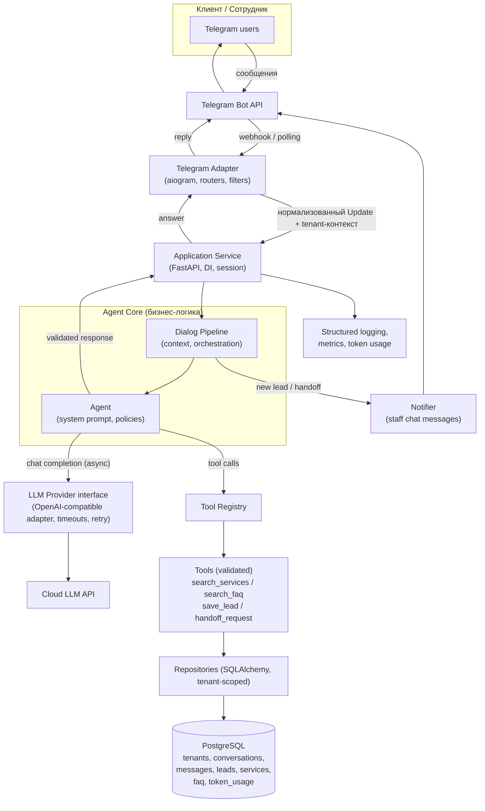

# ARCHITECTURE.md — Архитектура системы TGbots

> Статус: Initial Documentation (pre-development).
> Документ описывает целевую архитектуру MVP. Изменение архитектурных решений требует явного обновления этого документа.

---

## 1. Architecture Overview

TGbots — **модульный монолит** на Python, обслуживающий несколько Telegram-ботов (по одному на каждого tenant'а). Приложение:

1. принимает сообщения клиентов от Telegram (aiogram 3.x, webhook/polling);
2. обрабатывает их через application-слой в Agent Core;
3. Agent Core работает с LLM через абстракцию провайдера и вызывает инструменты (tools), реализованные backend'ом;
4. ответы валидируются и сохраняются в PostgreSQL;
5. ответ доставляется обратно в Telegram.

Ключевые свойства:

- бизнес-логика не зависит ни от Telegram, ни от конкретного LLM-провайдера;
- LLM не имеет прямого доступа к БД — только через контролируемые инструменты;
- все данные tenant'ов (диалоги, сообщения, лиды, услуги, FAQ, конфигурации) изолируются через `tenant_id`;
- критические бизнес-операции (лиды, handoff, записи) валидируются backend'ом, а не LLM.

## 2. Architectural Principles

1. **Modular Monolith.** Один процесс/образ, чёткие границы модулей. Микросервисы не применяются (запрещены для MVP).
2. **Independence of I/O adapters.** Бизнес-логика не зависит от Telegram-обработчиков и LLM-вендора. Telegram — это transport-драйвер, LLM — сменный провайдер за интерфейсом.
3. **Backend owns business truth.** LLM — генератор текста, источник правды — PostgreSQL и backend-логика. Все действия-инструменты агента валидируются: Pydantic-схемы входов/выходов, проверка прав, проверка tenant-контекста.
4. **Tenant isolation always.** Каждый запрос к customer-данным фильтруется `tenant_id`. Tenant-контекст передаётся явно (не через глобальное состояние).
5. **Explicit over implicit.** Никаких скрытых авто-магий; конфигурация и зависимости — явные (Pydantic-settings, DI-контейнер).
6. **Fail loud internally, fail polite externally.** Внутренние ошибки — в структурированные логи и метрики; наружу — вежливое fallback-сообщение клиенту.
7. **Asynchrony where appropriate.** Полностью async-стек (aiogram, FastAPI, SQLAlchemy async driver, async LLM SDK).
8. **Extensible tools.** Новые инструменты агента добавляются регистрации в реестре инструментов (tool registry) — без правки ядра Agent Core.
9. **Postponed complexity.** pgvector/RAG, CRM-интеграции, веб-панель — не реализуются в MVP, но архитектура допускает их добавление (отдельный модуль retrieval, интерфейсы без жёсткой привязки).

## 3. Technology Stack

| Слой | Технология | Назначение |
|---|---|---|
| Runtime | Python 3.12+ | Основной язык |
| Telegram | aiogram 3.x | Telegram Bot API: webhook/polling, FSM |
| HTTP API | FastAPI | Webhook endpoint, `/health`, служебные API |
| Валидация | Pydantic 2 (+ pydantic-settings) | Схемы данных, конфигурация |
| ORM/БД | SQLAlchemy 2 (async), Alembic | PostgreSQL, миграции |
| СУБД | PostgreSQL 16 | Все данные, full-text search |
| Vector search (позже) | pgvector (опционально) | RAG после MVP |
| LLM | облачные API (OpenAI-compatible и др.) через собственный provider-интерфейс | Генерация ответов |
| Тесты | pytest (+ pytest-asyncio) | Unit/инт/поведение агента/БД/изолированность |
| Деплой | Docker, Docker Compose | PostgreSQL + приложение |
| VCS | Git | Версионирование |

**Не входит в MVP:** Redis (состояние FSM — в PostgreSQL/памяти процесса), Celery/брокеры сообщений, Kubernetes, opaque админ-UI.

## 4. High-Level System Design



## 5. Main Application Modules

Предполагаемая структура пакетов (верхнеуровнево, без кода):

```text
src/
├── main.py                    # Точка входа, запуск FastAPI/aiogram
├── config/                    # Pydantic-settings, чтение env
├── telegram_adapter/          # Роутеры, фильтры, клавиатуры, webhook setup
├── api/                       # FastAPI-эндпоинты (webhook, health, internal)
├── application/               # Use cases: обработка сообщения, команд
├── agent_core/                # Agent, context builder, dialog state machine
├── llm_providers/             # Base interface + реализации (openai_compatible, ...)
├── tools/                     # Tool registry + реализации инструментов
├── knowledge/                 # Каталог услуг, FAQ, retrieval (MVP: FTS)
├── leads/                     # Лид-менеджмент (use cases, статусы)
├── handoff/                   # Human handoff (флаги, нотификации)
├── notification/              # Отправка уведомлений сотрудникам
├── db/                        # SQLAlchemy engine, session, модели, репозитории
├── monitoring/                # Логирование, счётчики, учёт токенов
└── tests/ (или tests/)        # pytest
```

Ответственность и границы: модуль может зависеть только от интерфейсов соседних; зависимость «верх → низ» (api → application → agent_core → tools/knowledge → db). Обратные зависимости и кросс-импорты модулей одного уровня не допускаются (проверяется review и, при необходимости, import-linter).

## 6. Telegram Integration

**Назначение:** приём и доставка сообщений, доставка уведомлений сотрудникам. Это transport-уровень.

- **aiogram 3.x** — один Dispatcher на всё приложение, webhook-режим в проде (проверка секретного токена в заголовке), polling — dev-режим.
- **Определение tenant'а.** К каждому tenant'у привязан токен бота. По `chat_id`/данным update и таблице соответствий бот → tenant вычисляется tenant-контекст; в webhook используется нужный Dispatcher/маршрутизация по токену.
- **Нормализация.** Update'ы превращаются во внутренние message-модели (Pydantic) — дальнейшие модули не знают о Telegram-структурах.
- **Доставка ответа.** Application-слой возвращает готовые message-модели; adapter отправляет их (текст, кнопки, fallback при обрыве сети с retry).
- **Rate limiting** — per-user лимит частоты сообщений (in-memory/DB счётчик), защита от flood.
- **Медиа в MVP** — не обрабатываются, вежливый отказ с просьбой написать текстом.

**Не делает:** бизнес-решений, работы с LLM, обращений к БД напрямую.

## 7. AI Agent Core

**Назначение:** решает, что ответить клиенту, с учётом контекста, знаний и политики tenant'а.

Состав:

- **Dialog State Machine** — состояние диалога (`greeting`, `need_discovery`, `consultation`, `objection_handling`, `lead_collection`, `handoff`). Состояние хранится в PostgreSQL (диалог), что позволяет восстановление после рестарта.
- **Context Builder** — собирает промпт: системные инструкции tenant'а + сжатая история диалога (окно N последних сообщений + краткие факты, собранные во время контакта) + результаты tool-вызовов.
- **Agent Loop** — итеративное взаимодействие с LLM: запрос → ответ или tool-call request → выполнение валидированного tool → доотправка → финальный ответ. Ограничение числа tool-петель за один ход (например, ≤ 5) против циклов.
- **Policies (Agent constraints)** — «никаких цен не из каталога», «deny handoff на handoff-диалоге», «deny раннего сбора данных», список разрешённых инструментов. Встраиваются в system prompt и проверяются кодом.
- **Response Validation** — проверка финального ответа: длина, отсутствие сырых технических артефактов, отсутствие запрещённых сущностей (ключи, инструкции). При failure — регенерация/безопасный fallback.

**LLM не является источником бизнес-правды:** любая фактическая информация о компании попадает в ответ через tool-результаты из backend'а.

## 8. LLM Provider Abstraction

**Назначение:** сменность провайдера и модели без изменения бизнес-логики.

```text
llm_providers/
├── base.py         # ABC/Base interface: complete(), complete_with_tools()
├── schemas.py      # Нейтральные модели: ChatMessage, ToolSpec, ToolCall, LlmResponse, Usage
├── openai_like.py  # Реализация OpenAI-compatible API
└── factory.py      # Выбор провайдера/модели из конфигурации tenant'а
```

Интерфейс (содержательно):

- `complete(messages, tools, model, temperature, timeout) -> LlmResponse`
- `LlmResponse` содержит текст и/или запрошенные tool-calls и `Usage` (токены prompt/completion/total).

Требования к реализации:

- тайм-ауты на вызов (конфигурируемые, default ~30 с) + ограничение числа ретраев с backoff;
- обработка ошибок: rate limit, network, нестабильные ответы — конвертируются в доменные исключения, приложение отвечает fallback-сообщением клиенту;
- учёт токенов — `Usage` сохраняется в таблицу `token_usage` по tenant'у и модели (cost tracking);
- конфигурируемая модель на tenant (дефолт + override);
- **Решено:** один основной провайдер (OpenAI-compatible) в MVP; интерфейс допускает подключение других (см. `docs/DEVELOPMENT_PLAN.md` §4).

## 9. Context and Conversation Management

- **Сущности:** `conversation` (tenant_id, bot_user identity, состояние, флаг handoff, timestamps), `message` (роль: user/agent/staff, текст, tool-метаданные, created_at).
- **Идентификация клиента:** Telegram `chat_id`/`user_id` привязывается к conversation по tenant'у; новому пользователю создаётся новая conversation.
- **Контекст для LLM:** последние N сообщений (окно) + сжатые факты (выявленная потребность, интересующие услуги, собранные контакты) — хранятся в conversation summary/поле, обновляются агентом по ходу диалога.
- **Лимиты:** ограничение размера контекста (N сообщений / токен-бюджет) — NFR-9.
- **Persistance:** каждое сообщение сохраняется до отправки ответа (transactional outbox-подход не обязателен, но запись сообщения идёт в той же транзакции, что и статусы).

## 10. Knowledge Base

**Назначение:** источники «правды» о компании tenant'а. Реализуется как модуль `knowledge/`.

**MVP-состав:**

- `services` — структурированный каталог: название, описание, цена/диапазон, длительность, теги/признаки для подбора, статус (активна/неактуальна).
- `faq` — вопрос, ответ, теги, статус.
- **Retrieval (MVP):** SQL-фильтры + PostgreSQL full-text search (russian language config). Инструменты `search_services(query, filters)` и `search_faq(query)` возвращают ограниченные выборки (top-k).
- **Обновление данных:** оператором (seed-данные/SQL/скрипт) в MVP.

**Расширяемость:** retrieval-функция скрыта за интерфейсом; при введении pgvector добавляется векторный/гибридный поиск без изменения Agent Core (меняется только реализация retriever'а и схема БД, а не pipeline).

## 11. Tool Execution Layer

**Назначение:** контролируемый мост между Agent Core и бизнес-данными/действиями.

Механика:

1. Agent Core получает от LLM запрос к инструменту (name + arguments).
2. Registry ищет инструмент по имени; если инструмент не разрешён для контекста (например, save_lead после handoff) — отказ.
3. Входные данные валидируются Pydantic-схемами (validation).
4. Инструмент исполняется backend-кодом: queries/commands через репозитории, tenant-обязателен.
5. Выходные данные валидируются по явно заданной схеме; любые бизнес-числа (цены) берутся ТОЛЬКО из БД, не из генерации LLM.
6. Результат (или понятная ошибка) возвращается в Agent Core для дальнейшего шага.

MVP-набор инструментов:

| Инструмент | Вход | Выход/эффект |
|---|---|---|
| `search_services` | запрос, фильтры, top-k | список услуг с ценами из каталога |
| `search_faq` | запрос, top-k | список Q/A |
| `save_lead` | контакт, суть, услуга, conversation_id | сохранённый lead + уведомление staff |
| `check_schedule` (модульный, включается только при backend-проверяемом источнике данных) | услуга/дата | проверенные backend'ом данные о доступности — инструмент реализуется, только если у tenant'а есть источник данных о расписании; при отсутствии — не включается |
| `handoff_request` | причина | флаг handoff, уведомление staff, остановка AI-ответов |

Реестр инструментов — декларативный: новый инструмент добавляется классом/объектом с Pydantic-схемами и регистрацией в registry; ядро не меняется.

## 12. Lead Management

- **Сущность `lead`:** tenant_id, conversation_id, контакт, суть запроса, услуга, статус (`new/in_progress/contacted/won/lost`), timestamps.
- **Use case `save_lead` валидирует данные, дубликаты (по conversation), сохраняет**, отправляет уведомление сотрудникам.
- **Только backend:** LLM может лишь вызвать инструмент; валидность и запись решает backend.
- **Уведомление staff** о лиде — через Telegram (см. §13).
- **Интеграции CRM** — Could Have; репозиторий lead скрыт за интерфейсом.

## 13. Human Handoff

- **Флаг handoff** у conversation; переключение — только через backend-процедуру (не через prompt-соглашение с LLM).
- **В handoff-режиме** Agent Core не вызывает LLM для входящих сообщений — входящие сохраняются как `user`-сообщения и требуют реакции staff.
- **Уведомление staff:** чат сотрудников tenant'а (преднастроенный в tenant_config) получает сообщение c идентификатором диалога и кратким контекстом. **Решено (базовый дизайн):** handoff идёт через внутренний Telegram-чат/группу; сотрудник отвечает reply-ом на уведомление, бот пересылает ответ клиенту и сохраняет его с ролью `staff`; детали reply-механики — PLAN-OD-5 в `docs/DEVELOPMENT_PLAN.md`. **Stage 7.2 дополнение (реализовано):** только reply на уведомление обрабатывается (не-reply игнорируется); `/back` возвращает диалог в AI (`handoffs.status=returned`, флаг сброшен); сообщения от ботов игнорируются всегда; без `staff_chat_id` handoff-запрос fail-closed без флага — агент продолжает работать; SYSTEM_ERROR-сбой модели создаёт handoff напрямую backend-процедурой без LLM.
- **Ответы staff:** сохраняются с ролью `staff` в `message`.
- **Возврат в AI-режим:** команда сотрудника (механика реализуется в MVP — через меню/клавиатуру бота).
- **Роутинг на сотрудников по темам/SLA** — не в MVP (Could Have).

## 14. Database Architecture

PostgreSQL. Схема (верхнеуровнево, детали — в `docs/DATABASE.md` после Фазы 2):

| Таблица | Назначение | Ключевые поля |
|---|---|---|
| `tenants` | Заказчики | id, name, status, llm config refs, timestamps |
| `tenant_config` | Настройки tenant'а | системные инструкции, модель, поведение, чат сотрудников, язык |
| `bots` | Сопоставление Telegram-ботов | token hash, tenant_id |
| `conversations` | Диалоги | tenant_id, внешний user id, state, handoff flag |
| `messages` | Сообщения | conversation_id, role, text, tool-метаданные |
| `leads` | Лиды | tenant_id, conversation_id, контакт, статус |
| `services` | Каталог услуг | tenant_id, название, описание, цена, флаги |
| `faq` | FAQ | tenant_id, вопрос, ответ, теги |
| `token_usage` | Учёт токенов | tenant_id, model, prompt/completion, created_at |
| `users` (карта идентичностей клиентов) | Привязка Telegram id к tenant'у | tenant_id, telegram_user_id, chat_id, служебные атрибуты |

Требования:

- SQLAlchemy 2 (async) + Alembic; явные FK и связи; `tenant_id` в customer-таблицах + composite indexes (tenant_id, ...).
- Транзакции для критических операций (создание лида + уведомление, переключение handoff).
- `pgvector` при появлении векторного поиска. **Решено:** изоляция на уровне приложения обязательна; PostgreSQL RLS добавляется позднее как дополнительный слой (см. `docs/DATABASE.md` §11).

## 15. Multi-tenant Isolation

Уровни:

1. **Application layer (обязательный):** tenant-контекст передаётся явно через сервис/репозиторий-параметры; каждый query к customer-таблицам фильтруется по `tenant_id`. Репозитории не принимают «tenant_id = null» для customer-данных.
2. **Database layer (опционально):** PostgreSQL RLS-политики по `tenant_id` как вторая линия защиты.
3. **Секреты tenant'ов:** токены ботов/LLM-ключи не в открытом виде в БД (шифрование/секрет-хранилище; детализация в `docs/SECURITY.md`).
4. **Security tests:** обязаны включать сценарии «tenant A пытается получить объект tenant B» — на уровне тестов tenant-изоляции (см. AGENTS.md §10).

## 16. Security Architecture

- **Секреты:** env-переменные/pydantic-settings, `.env.example` в репозитории без реальных значений; никакие ключи не в коде/логах.
- **Webhook:** проверка подписи/секретного токена; работа только по HTTPS; отклонение неаутентифицированных запросов.
- **Tenant auth:** каждый webhook-вызов привязан к токену бота и tenant'у; «чужой» токен не даёт доступ к чужому tenant.
- **Input validation:** Pydantic-валидация всех внешних входов (Telegram updates, admin API).
- **Rate limiting:** per-user на входящие сообщения; per-tenant на LLM-вызовы (бюджет токенов).
- **Tool-authorization:** whitelist разрешённых инструментов по состоянию диалога; пользовательские сообщения не могут «разрешить» запрещённый инструмент (prompt-injection protection — на уровне кода, не только prompt).
- **Privacy при отправке в LLM:** минимум контекста (история диалога неизбежно передаётся для качества ответа, но контактные данные/чувствительные поля — маскируются, **Open Decision:** конкретные маскируемые поля фиксирует `docs/SECURITY.md`). Передача данных LLM-провайдерам — требует правовой проверки (см. `docs/PRODUCT_SPEC.md` §16) — не является юридическим заключением.
- **Logging:** без персональных данных (маскирование/исключение), уровневые правила логирования.

## 17. Error Handling and Logging

- **Доменные исключения:** каждый модуль рождает понятные исключения (LLMTimeout, ToolValidationFailed, TenantNotFound и т. п.); «сырые» ошибки не пробрасываются наружу.
- **Fallback-стратегии:**
  - LLM недоступен/timeout → вежливое сообщение клиенту «техническая пауза», лог/метрика;
  - tool-ошибка → агенту возвращается структурированная ошибка, чтобы он скорректировал ход; при повторе — предложение handoff;
  - ошибка отправки в Telegram → retry с backoff, затем лог.
- **Structured logging:** JSON-логи, поля tenant_id/conversation_id/модуль/уровень; без текстов сообщений по умолчанию.
- **Metrics (базовые MVP):** счётчики входящих/исходящих сообщений, ошибок LLM, tool-ошибок, handoff, лидов, токенов (per tenant).

## 18. Deployment Architecture

- **Docker Compose:** сервисы — `app` (приложение) + `postgres` (объём для данных). Один инстанс `app` в MVP.
- **Режимы:** webhook (прод, за HTTPS-реверс-прокси/TLS от hosting-провайдера) и polling (dev).
- **Конфигурация:** переменные окружения (токены ботов, ключи LLM, DSN); `.env.example` шаблон.
- **Миграции:** Alembic-миграции применяются перед стартом (deploy-скрипт).
- **Мониторинг:** `/health` endpoint, структурированные логи наружу (stdout→collect).
- **Локализация данных:** серверы hosting — на территории РФ (требование 152-ФЗ-проектирования, обсуждается в `docs/SECURITY.md`; правовая проверка — перед коммерческим запуском).
- **Масштабирование (future):** второй инстанс `app` за LB, PostgreSQL → внешний managed-сервер, без изменения кода (без sticky state в приложении, состояние — в PostgreSQL).

## 19. Future Scalability

Архитектура допускает (без переписывания ядра):

- **RAG/векторный поиск:** добавление pgvector и гибридного retriever'а за тем же интерфейсом knowledge-модуля;
- **Новые каналы** (web widget, VK messenger) — как новые adapter'ы поверх application-уровня (бизнес-логика не знает о канале);
- **Новые инструменты агента** — декларативное добавление в Tool Registry;
- **Новые LLM-провайдеры** — реализация provider-интерфейса;
- **Разделение модулей на сервисы** — только если реальная нагрузка того потребует (не для MVP);
- **Аналитика** — построение отчётов из PostgreSQL/DWH поверх существующих таблиц, без вмешательства в приложение;

Не делаем преждевременно: микросервисы, message-brokers, Kubernetes, кэширующий слой Redis (см. AGENTS.md §14 и PRODUCT_SPEC §6).

---

## Open Decisions (сводка)

| № | Вопрос | Статус |
|---|---|---|
| OD-1 | Число поддерживаемых LLM-провайдеров в MVP | **Решено:** один основной провайдер (OpenAI-compatible); интерфейс допускает других — `docs/DEVELOPMENT_PLAN.md` §4 |
| OD-2 | PostgreSQL RLS с первого дня или позже | **Решено:** RLS — позднее как доп. слой; изоляция уровня приложения обязательна — `docs/DATABASE.md` §11 |
| OD-3 | Механика ответа сотрудника при handoff | **Решено (базовый дизайн):** внутренний Telegram-чат/группа; reply-механика — PLAN-OD-5 в `docs/DEVELOPMENT_PLAN.md` |
| OD-4 | Поле/метод маскирования персональных данных при отправке в LLM | **Частично решено:** минимизация ПДн обязательна; конкретные правила — `docs/SECURITY.md` (Этап 8) |
| OD-5 | Инструмент `check_schedule` — условия реализации | **Решено:** booking-модуль включается только при `booking_enabled` и проверяемом источнике данных — `docs/DATABASE.md` §4.9 |
| OD-6 | Механизм шифрования/хранения tenant-секретов | **Решён дизайн:** AES-256-GCM, AAD-привязка к тенанту, версионирование, ротация — `docs/SECURITY.md` §4–5; не в открытом виде (env/шифротекст/vault — `docs/DATABASE.md` §4.2); место master-ключа — SEC-OD-2 |
