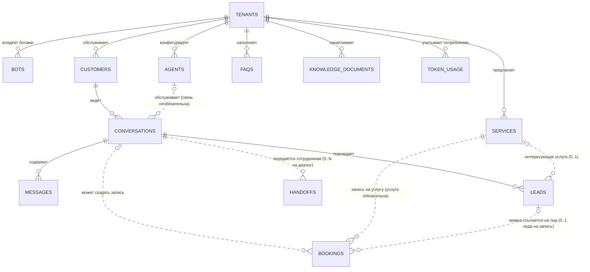

# DATABASE.md — Проект базы данных TGbots

> Статус: Initial Documentation (pre-development). На этом этапе документ описывает проект схемы PostgreSQL; SQL-миграции и Python-модели не создаются — они появятся на Этапе 2 (см. `docs/DEVELOPMENT_PLAN.md`).
> Схема согласована с `docs/ARCHITECTURE.md` (§14) и `docs/PRODUCT_SPEC.md` (§12–15).

---

## 1. Общие принципы и конвенции

| Правило | Решение |
|---|---|
| Идентификаторы | `UUID` для PK всех основных сущностей: `id UUID PRIMARY KEY DEFAULT gen_random_uuid()` (встроенная функция PostgreSQL 13+; расширение `pgcrypto` не требуется). Почему UUID: генерация без центрального счётчика, безопасные внешние ссылки, отсутствие перебора ID. |
| Время | Все временные поля — `timestamptz`, хранятся в UTC (`DEFAULT now()`), конвертация в часовой пояс тенанта — только на уровне отображения. |
| Timestamps | `created_at` (NOT NULL, `DEFAULT now()`) и `updated_at` — во всех изменяемых таблицах. `updated_at` поддерживает приложение (SQLAlchemy `onupdate`); вариант с триггером в БД — резервный, не обязателен в MVP. |
| Именование | snake_case, имена таблиц во множественном числе: `tenants`, `bots`, ... Тот же стиль — в моделях SQLAlchemy. |
| Tenant-режим | Каждая сущность заказчика содержит `tenant_id UUID NOT NULL REFERENCES tenants(id)`. Исключение — сама `tenants`, а также системные таблицы Alembic. |
| FK-политики | `ON DELETE RESTRICT` по умолчанию (данные не удаляются «каскадом вслепую»); исключения оговорены в §10 (архивирование/удаление) — каскад разрешён только для дочерних логических данных в рамках одного тенанта (messages → conversations). FK между тенантами невозможны архитектурно (см. §9). |
| Статусы | Нативные PostgreSQL-типы `ENUM` (создаются одной миграцией до таблиц). Список — §3. |
| Секреты | Никаких API-ключей и токенов в открытом виде. Схема хранит либо ссылку на секрет-хранилище, либо шифротекст (см. §12). |
| Регистр текста | Поиск услуг/FAQ — через сгенерированные `tsvector`-колонки с конфигурацией `russian` (см. §4). |

## 2. Сводный список таблиц

Основные (по заданию):

1. `tenants` — заказчики платформы.
2. `bots` — Telegram-боты заказчиков.
3. `agents` — конфигурации AI-агентов.
4. `services` — каталог услуг.
5. `customers` — конечные клиенты заказчиков.
6. `conversations` — диалоги.
7. `messages` — сообщения.
8. `leads` — заявки (лиды).
9. `bookings` — записи на услуги (используется, только если модуль включён у тенанта).
10. `knowledge_documents` — документы базы знаний (для RAG; в MVP заполняется опционально).
11. `handoffs` — передачи диалогов сотрудникам.

Вспомогательные (для согласованности с `ARCHITECTURE.md` §14):

12. `faqs` — FAQ тенанта (MVP-источник знаний наряду с `services`).
13. `token_usage` — учёт потребления токенов LLM.

Схема умышленно единой миграцией включает `bookings` и `knowledge_documents`, даже если они не используются: включение/выключение — на уровне приложения (`tenants.booking_enabled`), а не схемы. Это проще, чем условные миграции.

## 3. PostgreSQL ENUM-типы

```text
tenant_status        : active, suspended, archived
service_status       : active, inactive, archived
conversation_state   : greeting, need_discovery, consultation, objection_handling, lead_collection, handoff, closed
message_role         : user, agent, staff, system
lead_status          : new, in_progress, contacted, won, lost
lead_source          : agent, staff, operator
booking_status       : requested, confirmed, completed, cancelled, failed
handoff_trigger      : client_request, agent_decision, system_error
handoff_status       : active, returned, closed
document_status      : draft, published, archived
secret_source        : env, cipher, vault
```

## 4. Таблицы

### 4.1 tenants

**Назначение.** Заказчики платформы. Корень всех tenant-данных.

| Поле | Тип | Обяз. | Описание |
|---|---|---|---|
| id | uuid | PK | Суррогатный ключ тенанта |
| name | text | NOT NULL | Человекочитаемое название (компании). Уникально. |
| status | tenant_status | NOT NULL, DEFAULT 'active' | Состояние аккаунта |
| default_language | text | NOT NULL, DEFAULT 'ru' | Язык общения агента (MVP — только 'ru') |
| timezone | text | NOT NULL, DEFAULT 'Europe/Moscow' | Для отображения времени; datetime хранится в UTC |
| booking_enabled | boolean | NOT NULL, DEFAULT false | Флаг включения модуля записи (bookings) |
| retention_days | integer | NULL | Глубина хранения сообщений после закрытия диалога; NULL = глобальный дефолт (см. §10, Open Decision) |
| notes | text | NULL | Служебные заметки оператора (без персональных данных) |
| created_at / updated_at | timestamptz | NOT NULL | — |

- **PK:** `id`.
- **Уникальность:** `UNIQUE (name)`.
- **Индексы:** `ix_tenants_status (status)`.
- **Ограничения:** `CHECK (retention_days IS NULL OR retention_days BETWEEN 30 AND 1825)`.

### 4.2 bots

**Назначение.** Telegram-боты заказчиков. Связывает токен бота с тенантом (маршрутизация входящих webhook — по токену).

| Поле | Тип | Обяз. | Описание |
|---|---|---|---|
| id | uuid | PK | — |
| tenant_id | uuid, FK → tenants.id | NOT NULL | Владелец бота |
| bot_username | text | NOT NULL | `@username` бота |
| secret_source | secret_source | NOT NULL, DEFAULT 'env' | Где лежит токен: переменная окружения (`env`), шифротекст в БД (`cipher`) или внешнее хранилище (`vault`) |
| token_ciphertext | text | NULL | Шифротекст токена; заполнен только при `secret_source IN ('cipher','vault')` (для vault — метка/ссылка на секрет) |
| token_fingerprint | text | NOT NULL | Хэш (например, первые 16 hex-символов SHA-256) для обнаружения повторного использования токена; НЕ позволяет восстановить токен |
| webhook_secret_ciphertext | text | NULL | Шифротекст/метка секрета проверки webhook (допустим дефолт из платформенного env) |
| is_active | boolean | NOT NULL, DEFAULT true | Включён ли бот |
| created_at / updated_at | timestamptz | NOT NULL | — |

- **PK:** `id`.
- **FK:** `tenant_id → tenants.id` (ON DELETE RESTRICT).
- **Уникальность:** `UNIQUE (token_fingerprint)` — один токен не может обслуживать двух заказчиков; `UNIQUE (tenant_id, bot_username)`.
- **Индексы:** отдельный индекс по `tenant_id` не требуется — его обязательно отрабатывает `UNIQUE (tenant_id, bot_username)`.
- **Ограничения:** `CHECK (secret_source = 'env' AND token_ciphertext IS NULL OR secret_source IN ('cipher','vault') AND token_ciphertext IS NOT NULL)` — защита от plaintext-токена: в БД не хранится колонки для открытого токена вовсе.

### 4.3 agents

**Назначение.** Конфигурации AI-агента тенанта: системные инструкции, модель, политика инструментов.

| Поле | Тип | Обяз. | Описание |
|---|---|---|---|
| id | uuid | PK | — |
| tenant_id | uuid, FK → tenants.id | NOT NULL | Владелец |
| name | text | NOT NULL | Имя конфигурации (история версий) |
| system_prompt | text | NOT NULL | Системные инструкции (тон, специализация, запреты) |
| language | text | NOT NULL, DEFAULT 'ru' | Язык агента |
| model | text | NULL | Override модели; NULL = платформенный дефолт из env |
| temperature | numeric(3,2) | NOT NULL, DEFAULT 0.5 | — |
| max_context_messages | integer | NOT NULL, DEFAULT 12 | Окно истории для контекста запроса к агенту (NFR-9) |
| allowed_tools | text[] | NOT NULL, DEFAULT '{}' | Список разрешённых инструментов (whitelist) |
| objection_scripts | jsonb | NULL | Скрипты отработки возражений (FR-2.3) |
| welcome_message | text | NOT NULL | Приветствие при `/start` |
| is_active | boolean | NOT NULL, DEFAULT false | Активная конфигурация тенанта |
| created_at / updated_at | timestamptz | NOT NULL | — |

- **PK:** `id`.
- **FK:** `tenant_id → tenants.id` (RESTRICT).
- **Уникальность/индексы:**
  - частичный уникальный индекс: `UNIQUE (tenant_id) WHERE is_active` — не более одной активной конфигурации на тенанта;
  - `ix_agents_tenant (tenant_id)`.
- **Ограничения:** `CHECK (temperature BETWEEN 0 AND 2)`, `CHECK (max_context_messages BETWEEN 2 AND 100)`.

### 4.4 services

**Назначение.** Каталог услуг тенанта — источник правды о ценах/услугах (агент отвечает только из каталога, FR-3.3).

| Поле | Тип | Обяз. | Описание |
|---|---|---|---|
| id | uuid | PK | — |
| tenant_id | uuid, FK → tenants.id | NOT NULL | Владелец |
| name | text | NOT NULL | Название услуги |
| description | text | NOT NULL | Описание для консультации |
| price_min | numeric(12,2) | NULL | Цена или нижняя граница; NULL = цена по запросу |
| price_max | numeric(12,2) | NULL | Верхняя граница (диапазон) |
| currency | text | NOT NULL, DEFAULT 'RUB' | Валюта (MVP — RUB; ISO 4217) |
| duration_minutes | integer | NULL | Ожидаемая длительность |
| tags | text[] | NOT NULL, DEFAULT '{}' | Признаки подбора («мужская», «срочное», ...) |
| status | service_status | NOT NULL, DEFAULT 'active' | Активность услуги (soft delete через `archived`) |
| valid_until | date | NULL | Услуга действительна до этой даты; поиск учитывает актуальность (FR-3.7) |
| created_at / updated_at | timestamptz | NOT NULL | — |

- **PK:** `id`.
- **FK:** `tenant_id → tenants.id` (RESTRICT).
- **Уникальность:** `UNIQUE (tenant_id, name)` — дубли названий в каталоге одного тенанта запрещены.
- **Индексы:**
  - `ix_services_tenant_status (tenant_id, status) WHERE status = 'active'` — главный поисковый фильтр;
  - `ix_services_tags (tags)` — GIN, для поиска по тегам;
  - `ix_services_search_tsv (search_tsv)` — GIN, см. ниже.
- **FTS-колонка (генерируемая):**

```sql
search_tsv tsvector GENERATED ALWAYS AS
  (to_tsvector('russian', coalesce(name,'') || ' ' || coalesce(description,''))) STORED
```

- **Ограничения:** `CHECK (price_min IS NULL OR price_min >= 0)`, `CHECK (price_max IS NULL OR price_max >= 0)`, `CHECK (price_min IS NULL OR price_max IS NULL OR price_min <= price_max)`, `CHECK (duration_minutes IS NULL OR duration_minutes > 0)`.

### 4.5 customers

**Назначение.** Конечные клиенты заказчиков (пользователи Telegram), в разрезе тенанта.

| Поле | Тип | Обяз. | Описание |
|---|---|---|---|
| id | uuid | PK | Внутренний ID (не показывается клиенту) |
| tenant_id | uuid, FK → tenants.id | NOT NULL | Владелец |
| telegram_user_id | bigint | NOT NULL | Telegram ID пользователя |
| telegram_chat_id | bigint | NOT NULL | ID чата, в котором идёт диалог |
| username | text | NULL | Telegram-username (без @) |
| first_name | text | NULL | Имя из Telegram (для вежливого обращения; в логи не выводится) |
| phone | text | NULL | Телефон — записывается ТОЛЬКО через согласованное предоставление клиентом (лид-форма/сообщении); индексируется частично |
| language_code | text | NULL | Язык клиента по Telegram (справочный) |
| first_seen_at | timestamptz | NOT NULL | Первый контакт |
| last_seen_at | timestamptz | NOT NULL | Обновляется при каждом сообщении |
| created_at / updated_at | timestamptz | NOT NULL | — |

- **PK:** `id`.
- **FK:** `tenant_id → tenants.id` (RESTRICT).
- **Уникальность (в контексте заказчика!):** `UNIQUE (tenant_id, telegram_user_id)` — один пользователь Telegram в разных тенантах создаёт отдельные записи (защита от межклиентского доступа идентичности).
- **Индексы:**
  - `ix_customers_tenant_last_seen (tenant_id, last_seen_at DESC)` — retention-задачи и выборка активных;
  - `ix_customers_phone (tenant_id, phone) WHERE phone IS NOT NULL` — поиск лида по телефону.
- **Приватность:** `phone`, `username`, `first_name` — персональные данные; в логи не выводятся; при отписке/удалении тенанта — анонимизируются (§10).

### 4.6 conversations

**Назначение.** Диалог тенанта с клиентом; несёт состояние конечного автомата диалога и флаги (в т. ч. handoff).

| Поле | Тип | Обяз. | Описание |
|---|---|---|---|
| id | uuid | PK | — |
| tenant_id | uuid, FK → tenants.id | NOT NULL | Владелец |
| customer_id | uuid, FK → customers.id | NOT NULL | Участник диалога |
| agent_id | uuid, FK → agents.id | NULL | Конфигурация агента, обслужившая диалог; NULL — пока диалог создан без агента (снапшот для анализа, FK RESTRICT) |
| state | conversation_state | NOT NULL, DEFAULT 'greeting' | Текущее состояние автомата |
| handoff_active | boolean | NOT NULL, DEFAULT false | Флаг «диалог у сотрудника» (денормализовано из `handoffs` для быстрых фильтров) |
| context_summary | text | NULL | Сжатые факты диалога (потребность, интересующие услуги, собранные контакты) — обновляется агентом |
| message_count | integer | NOT NULL, DEFAULT 0 | Счётчик сообщений (денормализовано для статистики) |
| last_message_at | timestamptz | NOT NULL | Для окна поиска и retention |
| started_at | timestamptz | NOT NULL, DEFAULT now() | — |
| closed_at | timestamptz | NULL | Момент перевода в state='closed' |
| created_at / updated_at | timestamptz | NOT NULL | — |

- **PK:** `id`.
- **FK:** `tenant_id → tenants.id` (RESTRICT); `customer_id → customers.id` (RESTRICT); `agent_id → agents.id` (SET NULL — удаление устаревшей конфигурации не должно ронять историю).
- **Индексы:**
  - `ix_conversations_tenant_customer (tenant_id, customer_id)` — поиск диалогов клиента;
  - `ix_conversations_handoff (tenant_id) WHERE handoff_active` — активные handoff (диспетчер сотрудникам);
  - `ix_conversations_last_message (tenant_id, last_message_at DESC)` — retention-очистка.
- **Согласованность:** `handoff_active = true` тогда и только тогда, когда существует строка в `handoffs` со `status='active'` по данному диалогу; оба изменения — в одной транзакции (§7).

### 4.7 messages

**Назначение.** Сообщения диалога (в т. ч. ответы агента, сообщения сотрудника при handoff, системные).

| Поле | Тип | Обяз. | Описание |
|---|---|---|---|
| id | uuid | PK | — |
| tenant_id | uuid, FK → tenants.id | NOT NULL | Владелец (денормализовано для изоляции фильтров) |
| conversation_id | uuid, FK → conversations.id | NOT NULL | Диалог |
| role | message_role | NOT NULL | Отправитель: user / agent / staff / system |
| text | text | NOT NULL | Текст сообщения (media в MVP не хранится — см. FR-1.4) |
| telegram_message_id | bigint | NULL | ID в Telegram — для дедупликации и reply-ссылок при handoff |
| ai_model | text | NULL | Модель, сгенерировавшая ответ (роль='agent') |
| meta | jsonb | NULL | Служебные данные: вызовы инструментов (имя, аргументы, результат-ссылка), причины fallback |
| created_at | timestamptz | NOT NULL, DEFAULT now() | — (иммутабельна, без updated_at) |

- **PK:** `id`.
- **FK:** `tenant_id → tenants.id` (RESTRICT); `conversation_id → conversations.id` (ON DELETE CASCADE — при легитимном удалении диалога (§10) его сообщения удаляются вместе с ним).
- **Индексы:**
  - `ix_messages_conv_created (conversation_id, created_at)` — сборка контекста агента (главный путь чтения);
  - `uq_messages_tenant_tg (tenant_id, telegram_message_id) WHERE telegram_message_id IS NOT NULL` — идемпотентность webhook: повторная доставка Telegram не создаёт дубликатов (§7, NFR-8);
  - `ix_messages_tenant_role (tenant_id, role)` — статистика по ролям.
- **ПРИВАТНОСТЬ:** текст содержит персональные данные; в логи никогда не выводится (см. ARCHITECTURE §17); retention — §10.

### 4.8 leads

**Назначение.** Заявки/контакты, собранные агентом или оператором (FR-5).

| Поле | Тип | Обяз. | Описание |
|---|---|---|---|
| id | uuid | PK | — |
| tenant_id | uuid, FK → tenants.id | NOT NULL | Владелец |
| conversation_id | uuid, FK → conversations.id | NOT NULL | Диалог-источник |
| customer_id | uuid, FK → customers.id | NOT NULL | Клиент |
| service_id | uuid, FK → services.id | NULL | Интересующая услуга |
| contact_phone | text | NULL | Снапшот контакта на момент создания лида (дублируется из customers, чтобы лид «жил» независимо от правок профиля) |
| contact_username | text | NULL | Снапшот Telegram-username |
| intent | text | NOT NULL | Суть запроса |
| status | lead_status | NOT NULL, DEFAULT 'new' | Жизненный цикл (FR-5.3) |
| source | lead_source | NOT NULL, DEFAULT 'agent' | Кто создал |
| created_at / updated_at | timestamptz | NOT NULL | — |
| contacted_at | timestamptz | NULL | Первое касание сотрудника |
| closed_at | timestamptz | NULL | Перевод в won/lost |

- **PK:** `id`.
- **FK:** `tenant_id → tenants.id` (RESTRICT); `conversation_id` (RESTRICT); `customer_id` (RESTRICT); `service_id` (SET NULL — удаление услуги не должно ронять лид).
- **Индексы:** `ix_leads_tenant_status_created (tenant_id, status, created_at DESC)` — рабочая воронка.
- **Ограничения:** `CHECK (contact_phone IS NOT NULL OR contact_username IS NOT NULL)` — лид обязан содержать хоть какой-то контакт; `CHECK (closed_at IS NULL OR status IN ('won','lost'))`.
- **Дедупликация (FR-5.4):** частичный уникальный индекс `UNIQUE (conversation_id) WHERE status IN ('new','in_progress')` — один активный лид на диалог; повторные запросы того же диалога обновляют существующий, а не создают новый.

### 4.9 bookings

**Назначение.** Записи на услуги. Используется, только если у тенанта включён модуль (`tenants.booking_enabled`) и есть backend-верифицированный источник данных (см. PRODUCT_SPEC §7.4 / ARCHITECTURE §11).

| Поле | Тип | Обяз. | Описание |
|---|---|---|---|
| id | uuid | PK | — |
| tenant_id | uuid, FK → tenants.id | NOT NULL | Владелец |
| conversation_id | uuid, FK → conversations.id | NULL | Диалог-источник |
| customer_id | uuid, FK → customers.id | NOT NULL | Клиент |
| service_id | uuid, FK → services.id | NOT NULL | Услуга |
| lead_id | uuid, FK → leads.id | NULL | Родственная заявка |
| slot_at | timestamptz | NULL | Желаемое/проверенное время (UTC) |
| status | booking_status | NOT NULL, DEFAULT 'requested' | `requested` (создано агентом, не подтверждено) → `confirmed` (только backend-верификация) → ... |
| verified_by_backend | boolean | NOT NULL, DEFAULT false | Подтверждение записи backend'ом (AGENTS.md §5: без этого статус остаётся 'requested') |
| external_ref | text | NULL | Ссылка/ID в системе заказчика (когда появится интеграция) |
| created_at / updated_at | timestamptz | NOT NULL | — |

- **PK:** `id`.
- **FK:** все перечисленные выше (RESTRICT; lead_id — SET NULL).
- **Уникальность:** `UNIQUE (tenant_id, external_ref) WHERE external_ref IS NOT NULL`.
- **Индексы:** `ix_bookings_tenant_status (tenant_id, status)`, `ix_bookings_slot (tenant_id, slot_at) WHERE slot_at IS NOT NULL`.
- **Ограничения:** `CHECK (status = 'confirmed' AND verified_by_backend OR status <> 'confirmed')` — подтверждение без backend-верификации невозможно на уровне схемы.
- **MVP-поведение:** даже при `booking_enabled = true` агент НЕ подтверждает запись клиенту сам — только создаёт `requested` и направляет сотрудника на проверку (см. PRODUCT_SPEC FR-4.4/4.5 и Сценарий 1).

### 4.10 knowledge_documents

**Назначение.** Документы базы знаний (основа для RAG на следующем этапе). В MVP заполняется опционально; `services` + `faqs` — основной источник знаний MVP.

| Поле | Тип | Обяз. | Описание |
|---|---|---|---|
| id | uuid | PK | — |
| tenant_id | uuid, FK → tenants.id | NOT NULL | Владелец |
| title | text | NOT NULL | Название документа |
| content | text | NOT NULL | Текст документа |
| source_type | text | NOT NULL, DEFAULT 'manual' | Тип источника ('manual' / 'upload' / 'url') |
| source_ref | text | NULL | Ссылка/метка источника |
| status | document_status | NOT NULL, DEFAULT 'draft' | Публикация: 'draft' не отдаётся агенту |
| embedding | — | — | НЕ создаётся в MVP-миграции; векторная колонка pgvector будет добавлена отдельной миграцией при внедрении RAG (см. §11) |
| created_at / updated_at | timestamptz | NOT NULL | — |

- **PK:** `id`.
- **FK:** `tenant_id → tenants.id` (RESTRICT).
- **Индексы:** `ix_knowledge_docs_tenant_status (tenant_id, status) WHERE status='published'`; FTS GIN по `search_tsv` (та же GENERATED-колонка по `title`+`content`, что у services).

### 4.11 handoffs

**Назначение.** Передачи диалога сотрудникам (FR-6). Каждая строка — попытка handoff со своими жизненным циклом.

| Поле | Тип | Обяз. | Описание |
|---|---|---|---|
| id | uuid | PK | — |
| tenant_id | uuid, FK → tenants.id | NOT NULL | Владелец |
| conversation_id | uuid, FK → conversations.id | NOT NULL | Диалог |
| trigger | handoff_trigger | NOT NULL | Инициатор: клиент / агент / системная ошибка |
| status | handoff_status | NOT NULL, DEFAULT 'active' | Активный / сотрудник вернулся в AI / диалог закрыт |
| staff_chat_id | bigint | NOT NULL | Внутренний Telegram-чат или группа сотрудников (решение зафиксировано: handoff идёт через внутренний чат/группу) |
| staff_message_id | bigint | NULL | ID уведомления в чате сотрудников (для reply-механики ответов сотрудников) |
| note | text | NULL | Краткий контекст для сотрудников |
| initiated_at | timestamptz | NOT NULL, DEFAULT now() | — |
| returned_at | timestamptz | NULL | Возврат в AI-режим |
| created_at / updated_at | timestamptz | NOT NULL | — |

- **PK:** `id`.
- **FK:** `tenant_id` (RESTRICT); `conversation_id` (RESTRICT).
- **Уникальность (один активный handoff):** `UNIQUE (conversation_id) WHERE status = 'active'`.
- **Индексы:** `ix_handoffs_tenant_active (tenant_id) WHERE status='active'` — панель активных передач.
- **Согласованность:** активный handoff тогда и только тогда, когда `conversations.handoff_active = true` (обновление — в одной транзакции, §7).

### 4.12 faqs (вспомогательная)

**Назначение.** FAQ тенанта — второй MVP-источник знаний.

| Поле | Тип | Обяз. | Описание |
|---|---|---|---|
| id | uuid | PK | — |
| tenant_id | uuid, FK → tenants.id | NOT NULL | Владелец |
| question | text | NOT NULL | Вопрос |
| answer | text | NOT NULL | Эталонный ответ |
| tags | text[] | NOT NULL, DEFAULT '{}' | Теги тем |
| status | service_status | NOT NULL, DEFAULT 'active' | Доступность для агента (soft delete) |
| created_at / updated_at | timestamptz | NOT NULL | — |

- **PK / FK:** `id`; `tenant_id → tenants.id` (RESTRICT).
- **Уникальность:** `UNIQUE (tenant_id, question)`.
- **Индексы:** `ix_faqs_tenant_status (tenant_id, status) WHERE status='active'`; GIN по `search_tsv` (GENERATED по question+answer).

### 4.13 token_usage (вспомогательная)

**Назначение.** Учёт токенов LLM (NFR-6) — без внешних ключей на messages (чтобы интенсивная запись не нагружала основные таблицы).

| Поле | Тип | Обяз. | Описание |
|---|---|---|---|
| id | uuid | PK | — |
| tenant_id | uuid, FK → tenants.id | NOT NULL | Владелец |
| conversation_id | uuid | NULL | Без FK (только фильтр), чтобы удаление диалога не мешало статистике |
| provider | text | NOT NULL | Идентификатор провайдера |
| model | text | NOT NULL | Модель |
| prompt_tokens | integer | NOT NULL | — |
| completion_tokens | integer | NOT NULL | — |
| created_at | timestamptz | NOT NULL, DEFAULT now() | — |

- Индексы: `ix_token_usage_tenant_created (tenant_id, created_at DESC)`.

## 5. ER-диаграмма



Кардинальности: «|o..o{» = 0..N (необязательная связь); «||..o{» = 1..N (обязательная). Все связи проходят через `tenant_id` — во всех запросах таблицы фильтруются по одному тенанту (§9).

## 6. Ключевые целостностные связи (проверены)

- `conversations → tenants/customers/agents`: у диалога указаны tenant и customer (обязательны), agent — опционален.
- `messages → conversations`: сообщение не существует без диалога; conversation_id денормализован вместе с `tenant_id` (оба NOT NULL) для изоляции.
- `leads → conversations/customers`: лид всегда принадлежит контексту диалога/клиенту; `service_id` опционален.
- `handoffs → conversations`: handoff привязан ровно к диалогу (уникален активный на диалог).
- `bookings → customers/services`: booking не может существовать без клиента и услуги; conversation/lead — опциональны (запись может быть создана staff без диалога).
- Идентичность клиента уникальна в рамках тенанта: `customers (tenant_id, telegram_user_id)` — два тенанта могут иметь «одинакового» пользователя Telegram, их данные не пересекаются.
- Telegram message dedup: `messages (tenant_id, telegram_message_id)` — повторное сообщение не дублируется.
- Токены ботов уникальны: `bots.token_fingerprint`.

## 7. Транзакции

Изоляция по умолчанию — READ COMMITTED. Критичные операции выполняются в одной транзакции:

1. **Приём сообщения (webhook-идемпотентно):** `upsert customers` (по `tenant_id + telegram_user_id`) → `get/create conversations` → `insert messages` (с `telegram_message_id`). Дедуп — через уникальный индекс; при конфликте — операция считается выполненной (NFR-8).
2. **Сохранение лида (`save_lead`, инструмент):** `insert/upsert leads` (в рамках частичного unique по открытому лиду) + `update conversations.state/context_summary`. После COMMIT — уведомление сотрудникам (т.к. отправка в Telegram не транзакционна; сбой доставки фиксируется и ретраится, сам лид уже сохранён).
3. **handoff_request:** `insert handoffs (status='active')` + `update conversations.handoff_active/state` в одной транзакции; затем уведомление в чат сотрудников.
4. **Возврат из handoff:** `update handoffs.status='returned'` + `update conversations` — одна транзакция.
5. **booking_request (когда модуль вкл.):** `insert bookings status='requested'` + связанный `save_lead`, если лида ещё нет — одна транзакция.
6. **token_usage:** асинхронная фоновая вставка, транзакция не связана с основным потоком диалога; потери в аварийной остановке принимаются (некритичные данные).

Правила:

- Отправка ответов в Telegram — ТОЛЬКО после COMMIT (нет «полусохранённых» диалогов, сработавших в Telegram).
- Каких-либо распределённых транзакций/двухфазных commit нет и не планируется.
- Приложение не полагается на autocommit для критических путей.

## 8. Индексация (стратегия)

- Все composite-индексы на customer-данных начинаются с `tenant_id` — это основной фильтр изоляции.
- Частичные индексы (`WHERE status = 'active'` / `WHERE phone IS NOT NULL` / `WHERE role='agent'`) — правило проектировать индекс под конкретные запросы, а не индексировать всё подряд.
- GIN по `text[]` (tags) и `tsvector` (FTS) — услуги/FAQ/документы.
- messages: индекс (conversation_id, created_at) — главный путь чтения контекста; дополнительные индексы — минимальны, так как таблица write-heavy.
- Статистика и мониторинг использования индексов — после запуска (`pg_stat_user_indexes`), неиспользуемые — удаляются.

## 9. Изоляция tenant-данных на уровне приложения

Обязательный уровень (решение зафиксировано заданием):

1. Каждый запрос к customer-таблицам передаёт `tenant_id` в репозиторий в явном виде (аргумент `TenantContext`); запросов без фильтра по `tenant_id` для tenant-таблиц не существует ни в бизнес-коде, ни в ad-hoc SELECT'ах.
2. Репозитории (SQLAlchemy) всегда добавляют `WHERE tenant_id = :tenant_id` в SELECT/UPDATE/DELETE; INSERT всегда устанавливает tenant_id из контекста, а не из пользовательских данных.
3. Отсутствие фильтра — предмет review + автоматических security-тестов (сценарий «tenant A читает объект tenant B по ID» обязан возвращать 404/None — тест категории «security/tenant isolation», AGENTS.md §10).
4. LLM имеет доступ только к данным, переданным в промпт/инструменты backend'ом; объявленные инструменты работают строго в рамках текущего tenant.

RLS — второй уровень (§11), но не заменяет первый.

## 10. Удаление и архивирование данных

**Soft delete (основной путь):** `services.status='archived'`, `faqs.status='archived'`, `agents.is_active=false` + новая конфигурация, `bots.is_active=false`, `knowledge_documents.status='archived'`. История диалогов/лидов не удаляется при этом.

**Retention сообщений/диалогов:**

- После закрытия диалога (`conversations.state='closed'`) сообщения и диалог могут быть удалены по прошествии `retention_days` (настройка тенанта или платформенный дефолт).
- **Open Decision:** платформенный дефолт `retention_days` (предложение: 180 дней) — фиксируется в `docs/SECURITY.md` до запуска.
- **Open Decision:** мягкое «архивирование» в отдельную append-only таблицу перед удалением (для аналитики) vs полная очистка — решается при добавлении аналитики; в MVP допускается простая очистка.

**Анонимизация:** при приостановке/архивации тенанта и по запросу клиента — телефон/username/имя в `customers` и снапшоты в `leads` обнуляются (анонимизация), IDs и статистика сохраняются; связанное удаление «персонифицированных» данных в `messages` — по требованию (Open Decision: правило для текстов сообщений задаётся в `docs/SECURITY.md`).

**Offboarding тенанта:** последовательность — `tenants.status='archived'` → отключение ботов (`bots.is_active=false`, токены удаляются из секрет-хранилища) → по истечении срока скрытия (Open Decision: 30–90 дней) полное удаление данных тенанта (каскад по FK: messages → conversations, leads, bookings и т. д.).

**Cascade-правила:** только `messages.conversation_id` имеет ON DELETE CASCADE (удаление диалога уничтожает свои сообщения). Остальные связи — RESTRICT/SET NULL, чтобы исключить молчаливые потери лидов/booking'ов.

## 11. Внедрение PostgreSQL Row Level Security позднее

Схема проектируется RLS-ready:

- все tenant-таблицы имеют NOT NULL колонку `tenant_id` с одинаковым именем;
- доступ приложения выполняется под выделенной ролью (не суперюзером), что позволяет включить RLS без изменения бизнес-кода;
- план внедрения (все это НЕ создаётся сейчас):
  1. `ALTER TABLE <tenant_table> ENABLE ROW LEVEL SECURITY; FORCE ROW LEVEL SECURITY;`
  2. `CREATE POLICY tenant_isolation ON <tenant_table> USING (tenant_id = current_setting('app.current_tenant')::uuid) WITH CHECK (tenant_id = current_setting('app.current_tenant')::uuid);`
  3. Драйвер: перед каждой транзакцией `SET LOCAL app.current_tenant = '<uuid>'` (SET LOCAL действует только в пределах транзакции);
  4. Миграции Alembic — под ролью-владельцем схемы (RLS не применяется к владельцу, если не FORCE);
  5. Отдельный пласт тестов: подключение без `app.current_tenant` должно давать пустой результат (fail-closed).

Сроки включения не фиксируются: изоляция на уровне приложения обязательна и достаточна; RLS — предупреждающий второй слой, который может быть включён в любой момент позднее.

## 12. Хранение секретов

- **Платформенные секреты** (API-ключи LLM по умолчанию, токен админ-API, DSN) — только вне кода: env-переменные / секрет-хранилище хостера. В репозитории лишь `.env.example`.
- **Tenant-секреты** (токены ботов, webhook-секреты) — НЕ в открытом виде (решение зафиксировано заданием): варианты — переменная окружения, шифрование на стороне приложения (`bots.token_ciphertext`) или внешнее хранилище (`vault`).
- **Решено (дизайн):** authenticated encryption AES-256-GCM (библиотека `cryptography`), AAD-привязка шифротекста к tenant_id/bot_id, версионирование ключей и процедура ротации — `docs/SECURITY.md` §4–5; место хранения master-ключа — SEC-OD-2 (`docs/SECURITY.md` §19).
- Логи никогда не содержат секретов; логирование значений секретов исключается фильтрами на уровне настройки структурированного логирования.

## 13. Миграции Alembic

- Alembic init — на Этапе 2; каталог `migrations/` в корне проекта; версии синхронизированы с git.
- Порядок первой миграции: ENUM-типы → `tenants` → tenant-таблицы (в порядке FK: bots, agents, services, customers, conversations, messages, faqs, knowledge_documents, leads, handoffs, bookings, token_usage).
- Генерация — `alembic revision --autogenerate` с последующей ручной проверкой (autogenerate может ошибаться в генерируемых колонках и частичных индексах — verify вручную).
- Naming convention (SQLAlchemy metadata): `ix_%(table)_%(column)s`, `uq_...`, `ck_...`, `fk_...` — для предсказуемых имён в БД.
- Каждая миграция содержит работающий `downgrade()`, если это возможно без потери данных; destructive-шаги — отдельными миграциями с комментарием «destroyed».
- Deploy-процесс: `alembic upgrade head` перед стартом приложения (см. ARCHITECTURE §18).
- Данные/seed (первичный tenant, демо-тестовый каталог) — отдельные data-миграции или скрипты вне alembic history; прод-миграция не содержит заказных данных.

## 14. Политика резервного копирования

Требование 152-ФЗ: данные — на серверах в РФ, включая бэкапы.

| Параметр | Цель / решение |
|---|---|
| Полный бэкап | Ежедневно (off-peak, UTC ночь) |
| WAL-архивирование | Непрерывно (point-in-time recovery) |
| Цели восстановления | RPO ≤ 15 мин; RTO ≤ 2 ч (не жёсткий SLA, ориентиры) |
| Хранение | 30 дней ротации; копии — только на серверах в РФ, шифрованы на диске |
| Тест восстановления | Restore-тест не реже одного раза в месяц на отдельной копии БД; оператор проверяет ключевые таблицы и счётчики |
| Точный инструмент | **Open Decision:** управляемый PostgreSQL российского хостера (его встроенные бэкапы) vs pgBackRest/wal-g на собственном VPS — фиксируется на Этапе 8 |
| Доступ | Бэкапы доступны только оператору; бэкап содержит персональные данные — доступ логируется |

## 15. Open Decisions (сводка по БД)

| № | Вопрос | Место решения |
|---|---|---|
| DB-OD-1 | Дефолтный период retention закрытых диалогов (предложение 180 дней) | `docs/SECURITY.md`, до запуска |
| DB-OD-2 | Правила анонимизации текстов сообщений по требованию | `docs/SECURITY.md` |
| DB-OD-3 | Срок полного удаления данных при offboarding (предложение 30–90 дней) | `docs/SECURITY.md` |
| DB-OD-4 | Шифрование tenant-секретов | Дизайн решён (AES-256-GCM, версии, ротация) — `docs/SECURITY.md` §4–5; хранение master-ключа — SEC-OD-2 |
| DB-OD-5 | Инструмент бэкапов (managed PG vs pgBackRest/wal-g) | Этап 8 |
| DB-OD-6 | Архивирование сообщений в append-only таблицу перед удалением | при добавлении аналитики (после MVP) |
